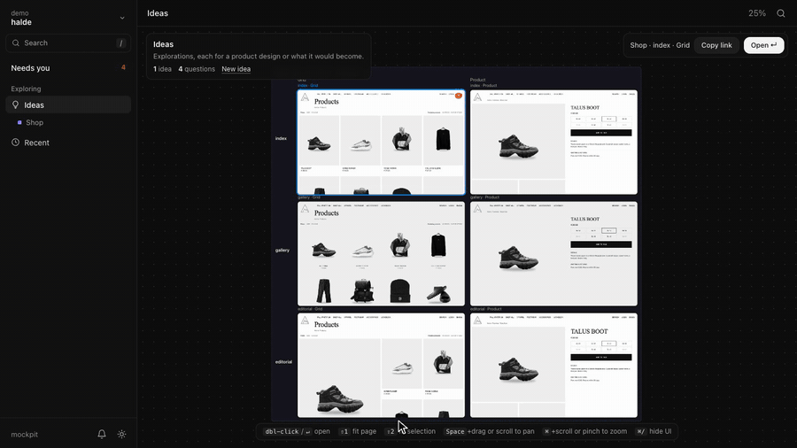
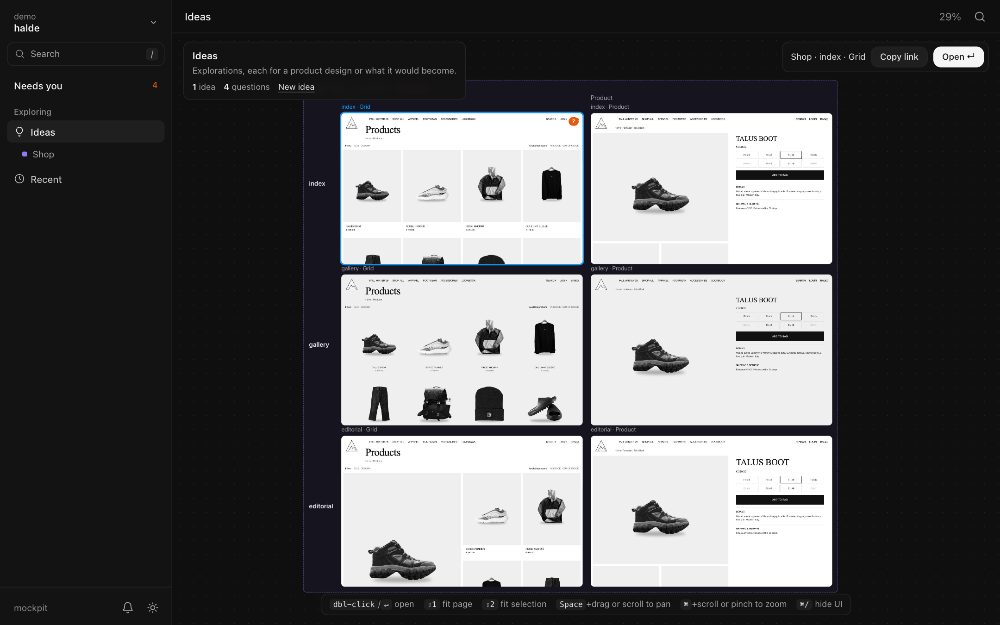
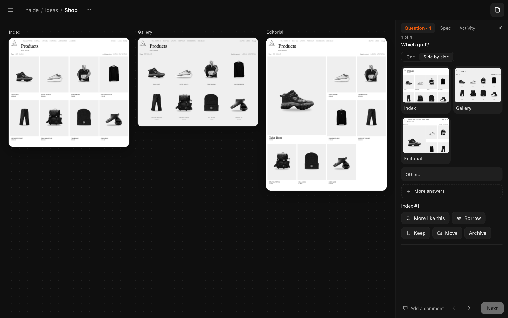

# mockpit

**A design loop for terminal coding agents. Your agent shows designs in your browser; you
compare, pick and press Send once, or Use to put your picks in the product.**

The agent publishes a screen in its states, a few alternatives and the knobs worth trying, then
ends its turn. You see the project on a Board, open the design in Focus, spread a knob into a
sheet of every frame in every value, pick and star what works, tune, and comment on parts. It
asks a question only when it can't go on without you. One Send gives the agent the whole reply.
Nothing it calls waits for you.

<a href="docs/mockpit-demo.gif"></a>

## Quickstart

Needs Node 22.18 or newer.

```sh
npm i -g mockpit
mockpit serve --open     # http://localhost:8228
mockpit demo             # seeds a sample design to click through
```

Point your agent at it, once per repo:

```sh
curl -s http://localhost:8228/setup >> AGENTS.md
mockpit init             # reads the repo's tokens, fonts and kit
```

Then ask it to "design this up on mockpit". Claude Code, Codex, OpenCode, Pi and MCP setup:
[docs/connecting-agents.md](docs/connecting-agents.md).

## A turn

```sh
mockpit publish --design shop --state Grid --alternative index --html index.html
mockpit publish --design shop --state Grid --alternative gallery --html gallery.html \
  --knobs '{"density": {"type": "select", "options": ["airy", "packed"]}}'
# the agent says where to look and stops. After your Send or Use:
mockpit feedback
```

## What you can do with a design

- **Spread** a knob: every frame in every value, on one sheet. Click any cell to inspect it
  full-size beside a live choice panel or **Side by side** finalist grid that shrinks as you
  cull options.
- **Main, Bookmark & Delete**: star a **Main** (`M`) per frame and knob (each frame remembers
  its combo across knobs), **Bookmark** (`K`) runners-up, and **Delete** (`X`) options you
  don't want — they vanish at once (with Undo) and stay silently ruled out for the agent.
- **Pick one or Keep all (Sets)**: flip any idea between picking one winner or keeping all
  items as a Set (like a collection of hero illustrations that all ship), each styled with its
  own `★ Main` per knob.
- **Save a look**, the knob values you tuned, and give it to another frame or design with one
  click.
- **Tune** the knobs the agent declared, **borrow** a part from another alternative,
  **comment** on any part, and ask for **more like this**. All of it waits in Send's list.
- **Use** your decisions: picks (or every live item in a Set, wearing its `★ Main` values) go
  into the product design, and the agent hears "put this in the code".
- **Answer** the agent's questions from pictures, side by side at full height.

Two places. The **Board** lays a project out like a designer's file: a page per area, a section
per flow, every frame under its name, a map of what's left to design, and a mark on what the
agent just changed. **Focus** is one design, live, with its question, its spec and the agent's
activity. Every link opens on the Board, fit to that design; Enter or a double-click opens
Focus. Needs you lists what's waiting on you. On a phone the Board is rows you swipe, and Focus
is one frame with the question in a sheet.

<table>
  <tr>
    <td width="50%"><a href="docs/mockpit-board.png"></a></td>
    <td width="50%"><a href="docs/mockpit-question.png"></a></td>
  </tr>
</table>

## What it shows

Html with parts and knobs, plus markdown, diff, terminal, image, mermaid, json and code. All of
it renders in a sandboxed frame.

## Agent side

Twelve verbs, the same on the zero-dependency CLI, MCP (stdio, or HTTP at `/mcp`) and plain
HTTP: `publish`, `ask`, `read`, `feedback`, `say`, `move`, `edit`, `system`, `export`,
`upload`, `guide`, `run`. `mockpit watch` wakes a waiting agent on each Send.

Agents read a short brief before their first publish (`/agent-howto`). Add your own taste in
`~/.mockpit/rules.md`, or per repo in `.mockpit/rules.md`.
[`examples/rules.md`](examples/rules.md) is one.

## Where it runs

Locally, a small Node server with SQLite at `~/.mockpit/mockpit.db`. When the agent and browser
are on different machines, deploy it to Cloudflare Workers: [docs/deploying.md](docs/deploying.md).

## Development

```sh
git clone https://github.com/fabiogaliano/mockpit && cd mockpit
npm install
npm run dev        # server + viewer watch build
npm run typecheck && npm run lint && npm run format:check
```

Architecture and rules: [AGENTS.md](AGENTS.md).

## Credits

A fork of [sideshow](https://github.com/modem-dev/sideshow) by
[Ben Vinegar](https://github.com/benvinegar), sponsored by [Modem](https://modem.dev). The
renderer, sandboxing, agent tiers and Cloudflare deploy started there.

[MIT](LICENSE). The original sideshow copyright is retained.
