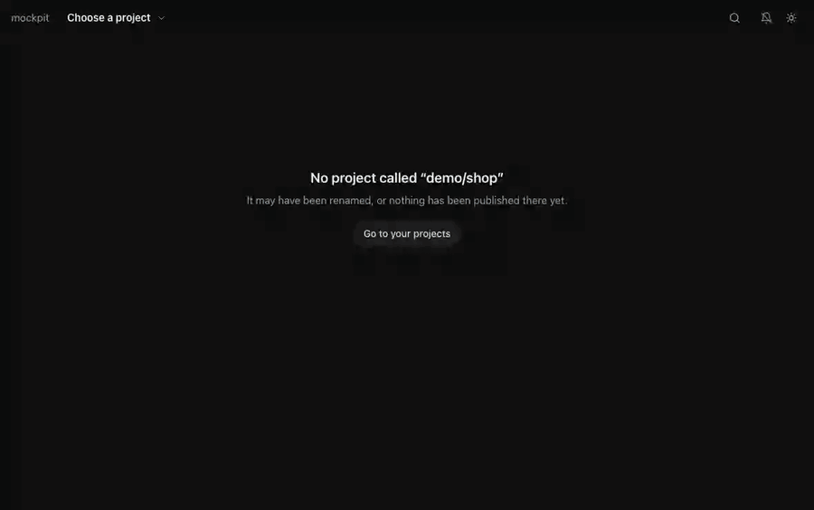
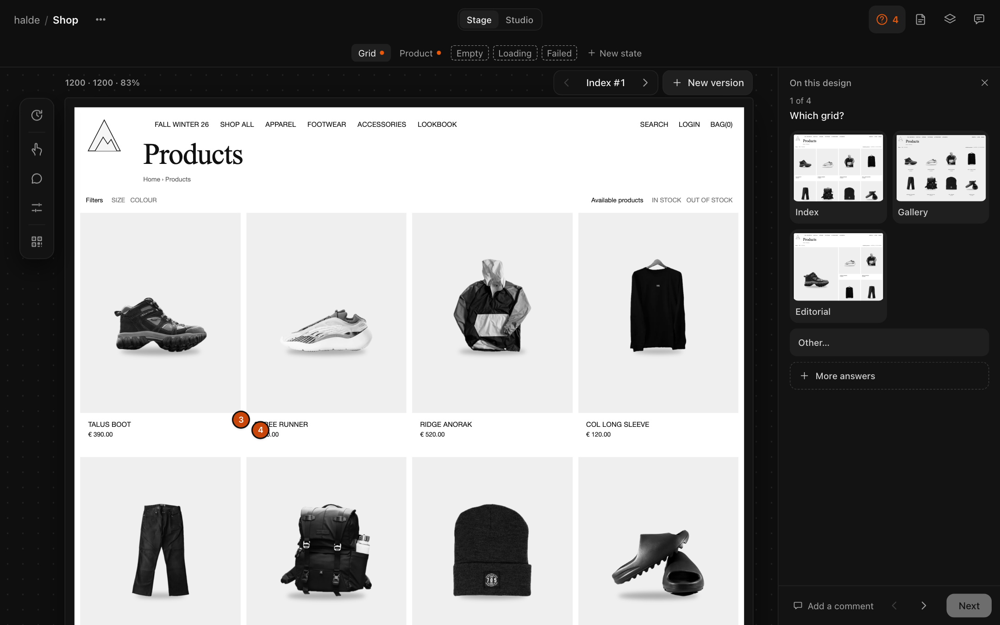
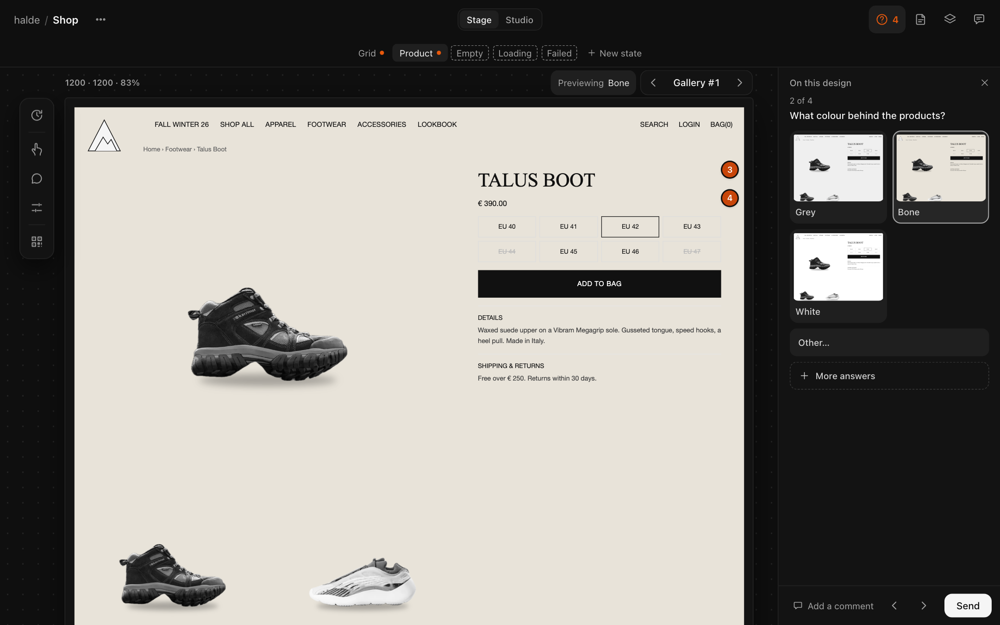

# mockpit

**A design loop for terminal coding agents. Your agent shows designs in your browser and asks
its questions there. You answer in place and press Send once.**

The agent publishes a screen in its states and a few alternatives, then ends its turn. You compare
them from pictures, tune knobs, comment on parts and keep the runners-up. One Send gives the
agent the whole reply. Nothing it calls waits for you.

<a href="docs/mockpit-demo.gif"></a>

## Quickstart

Needs Node 22.18 or newer.

```sh
npm i -g mockpit
mockpit serve --open     # http://localhost:8228
mockpit demo             # seeds a sample design to click through
```

Point your agent at it, once per repo:

```sh
curl -s http://localhost:8228/setup >> AGENTS.md
mockpit init             # reads the repo's tokens, fonts and kit
```

Then ask it to "design this up on mockpit". Claude Code, Codex, OpenCode, Pi and MCP setup:
[docs/connecting-agents.md](docs/connecting-agents.md).

## A turn

```sh
mockpit publish --design shop --state Grid --alternative index --html index.html
mockpit publish --design shop --state Grid --alternative gallery --html gallery.html
mockpit ask --design shop "Which grid?" --option Index=index --option Gallery=gallery
# the agent says where to look and stops. After your Send:
mockpit feedback
```

## What you can do with an answer

- **Pick** from pictures. Hover to preview it on the stage.
- **Keep** runners-up. After Send they stay beside the design, one click from Use this instead.
- **Archive** what you don't want, with a reason if you like. The agent won't offer it again.
- **Ask for more** answers without sending the rest of your draft.
- **Save a combo** of answers across questions, like Warm or Quiet, and switch between combos.
- **Tune** the knobs the agent declared, **borrow** a part from another alternative, and
  **comment** on any part.

Studio puts every alternative side by side. Home groups a project's ideas, screens, flows and
components, and Needs you lists what's waiting on you.

<table>
  <tr>
    <td width="50%"><a href="docs/mockpit-question.png"></a></td>
    <td width="50%"><a href="docs/mockpit-preview.png"></a></td>
  </tr>
</table>

## What it shows

Html with parts and knobs, plus markdown, diff, terminal, image, mermaid, json and code. All of
it renders in a sandboxed frame.

## Agent side

Eleven verbs, the same on the zero-dependency CLI, MCP (stdio, or HTTP at `/mcp`) and plain
HTTP: `publish`, `ask`, `read`, `feedback`, `say`, `move`, `edit`, `export`, `upload`,
`guide`, `run`. `mockpit watch` wakes a waiting agent on each Send.

Agents read a short brief before their first publish (`/agent-howto`). Add your own taste in
`~/.mockpit/rules.md`, or per repo in `.mockpit/rules.md`.
[`examples/rules.md`](examples/rules.md) is one.

## Where it runs

Locally, a small Node server with SQLite at `~/.mockpit/mockpit.db`. When the agent and browser
are on different machines, deploy it to Cloudflare Workers: [docs/deploying.md](docs/deploying.md).

## Development

```sh
git clone https://github.com/fabiogaliano/mockpit && cd mockpit
npm install
npm run dev        # server + viewer watch build
npm run typecheck && npm run lint && npm run format:check
```

Architecture and rules: [AGENTS.md](AGENTS.md).

## Credits

A fork of [sideshow](https://github.com/modem-dev/sideshow) by
[Ben Vinegar](https://github.com/benvinegar), sponsored by [Modem](https://modem.dev). The
renderer, sandboxing, agent tiers and Cloudflare deploy started there.

[MIT](LICENSE). The original sideshow copyright is retained.
