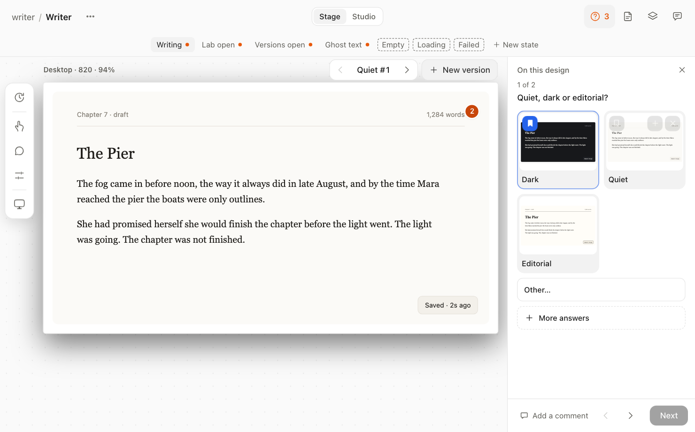
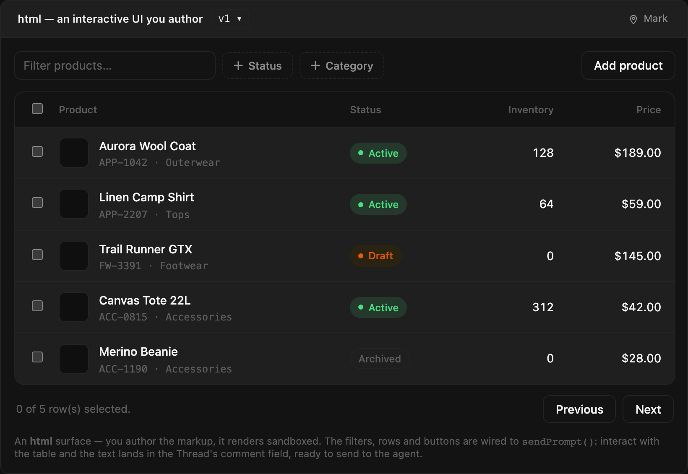
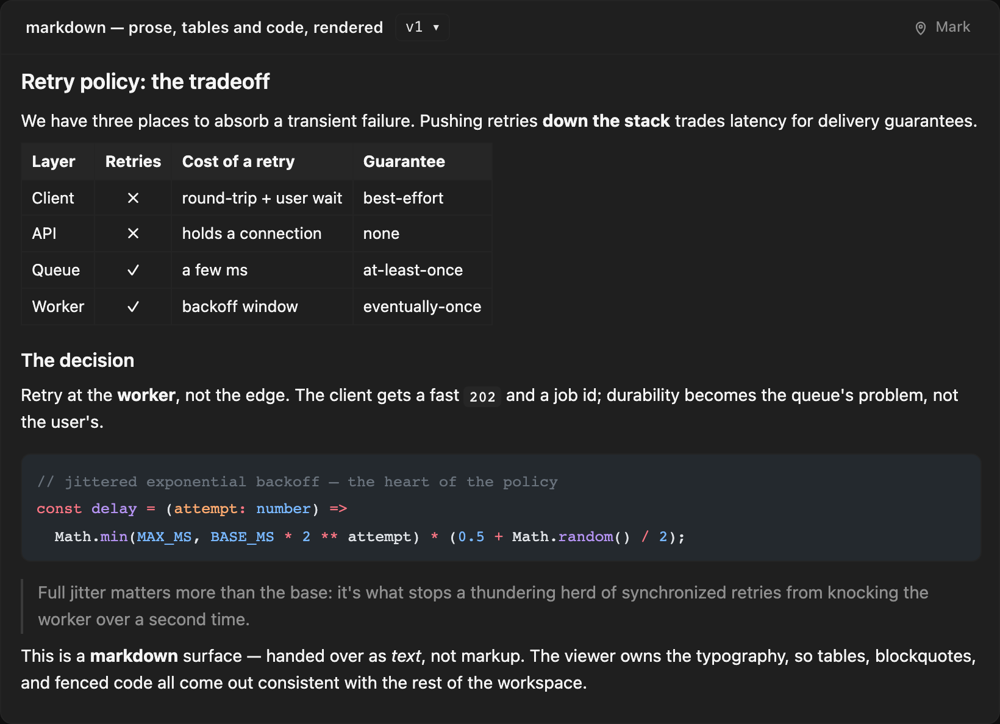
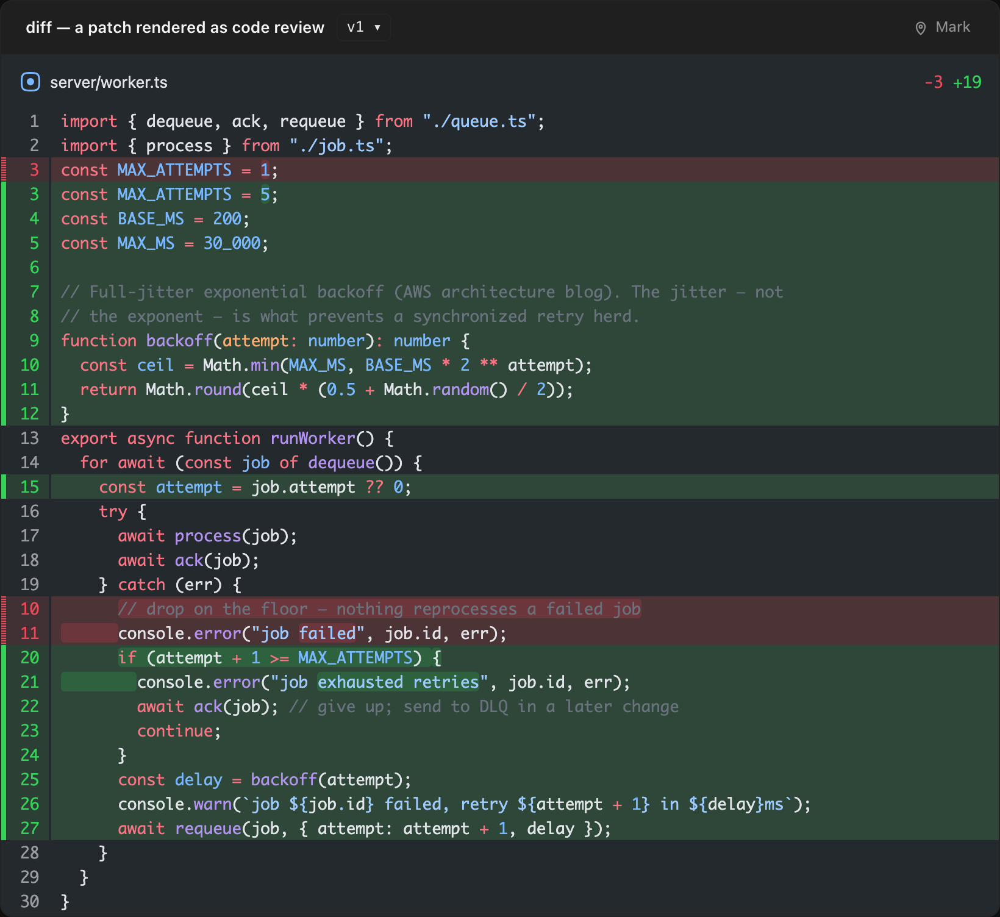
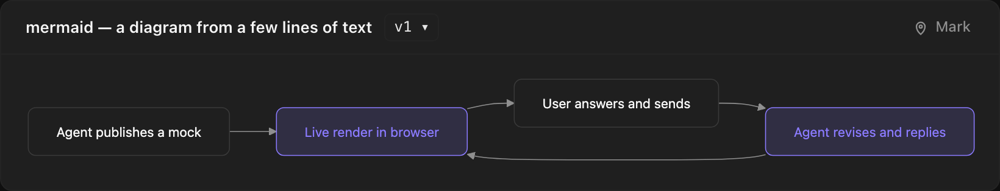

# mockpit

**A design-decision loop for terminal coding agents.**

Your agent publishes a design (a screen or component) in each UI state and a few parallel variants. It appears live in your browser with the agent's questions beside it. Pick a variant from pictures, tune the knobs, comment on declared parts, then press **Send**. Nothing the agent calls waits for you: it gets the whole batch once and revises.

<table>
  <tr>
    <td width="50%" valign="top">
      <picture>
        <source media="(prefers-color-scheme: dark)" srcset="docs/mockpit-dark.png">
        
      </picture>
    </td>
    <td width="50%" valign="top">
      
    </td>
  </tr>
</table>

## Fork of sideshow

mockpit is a fork of [sideshow](https://github.com/modem-dev/sideshow) by [Ben Vinegar](https://github.com/benvinegar), sponsored by [Modem](https://modem.dev). The renderer, sandboxing, MCP/CLI/HTTP tiers and Cloudflare deploy come from that work. Thank you.

|               | sideshow                                           | mockpit                                                                                                                            |
| ------------- | -------------------------------------------------- | ---------------------------------------------------------------------------------------------------------------------------------- |
| Structure     | A stream of posts per session                      | **project › design › state › variant › version**: a repo, a screen or component by slug, its UI states, parallel variants, history |
| Questions     | Free-text comments                                 | The agent asks; you answer in place, picking from pictures of each option                                                          |
| Tuning        | —                                                  | Knobs the agent declares (sliders, colours, springs…) on [tunekit](https://github.com/fabiogaliano/tunekit), live on the stage     |
| Comments      | Text on a post                                     | Anchored on a **part** the agent declared with `data-part`, in a given state                                                       |
| Feedback      | Each comment reaches the agent as it's written     | Picks, tuned values, borrowed parts and comments stay drafts until you **Send**, then go out as one reply                          |
| Design system | Built-in viewer themes                             | `mockpit init` detects the repo's tokens, fonts and kit so the agent's markup matches your codebase                                |
| Agent verbs   | Post-level: `publish`, `update`, `wait`, `comment` | Design-level, never blocking: `publish`, `ask`, `read`, `feedback`, `say`, `move`, `edit`, `export`, `upload`, `guide`, `run`      |

## The loop

1. **Publish.** The agent publishes each state ("Writing", "Lab open") in one or more variants ("quiet", "dark").
2. **Ask.** The agent asks what it can't decide alone, in the design rather than in chat, then tells you where to look and ends its turn.
   - Options bound to a variant or knob values render as pictures: hover previews on the stage, click picks, and the changed part is outlined.
   - A part with fills (one `data-part`, a `data-fill` per alternative) is asked about once; a part inside a fill is asked only while that fill is chosen.
   - Variants left unasked get a built-in **Which variant?**.
3. **Tune.** Declared parts are selectable on the stage. Tune lists each with its knobs, a comment field, and a **Borrow** line when another variant draws it differently. Presets save tuned values in your browser.
4. **Send.** Everything above is a draft that survives a reload until one **Send**. A design with one variant and no questions gets **Use this / New version** instead. The Send shows in the Thread as **Not seen yet**, then **Delivered**. If it isn't picked up, tell your agent you've answered.
5. **Revise.** The agent gets one reply (answers, tuned values, borrowed parts, comments) on its next write or `feedback` call; `mockpit watch` under a background monitor wakes it to make one. It publishes the next version, named by its variant's number ("Dark #2"). The version bar walks the history, **Use this** puts an older one back in use, and variants that lost are archived, not deleted.

**Home** lists the project's designs with a thumbnail, their states and open questions; "Answer next ›" jumps to the first. The top bar toggles dark and light.

On a phone or a portrait iPad, the design is a canvas you pan and pinch, side by side at each width the agent names (or one you pick: Phone 390, Tablet 744, Desktop 820, Wide 1280). Questions float over it in a card you can snap to a corner, a side or the bottom, or tuck against an edge.

## Quick start

Requires Node 22.18 or newer.

```sh
git clone https://github.com/fabiogaliano/mockpit && cd mockpit
npm install
npm start                      # viewer on http://localhost:8228
npm link                       # puts the `mockpit` CLI on your PATH
```

Paste the setup block into your agent's instructions:

```sh
curl -s http://localhost:8228/setup >> AGENTS.md
```

Run `mockpit init` once per repo, then ask the agent to "design this up on mockpit". No agent handy? `mockpit demo` seeds the Writer: one design in four states and three variants, with questions, knobs and declared parts.

MCP and the Pi, Claude Code, Codex and OpenCode integrations are in **[docs/connecting-agents.md](docs/connecting-agents.md)**.

## What a design can show

A version is an ordered list of **surfaces**. Html is the only kind with parts and knobs; the others render the same way on the stage.

<table>
  <tr>
    <td width="50%" valign="top">
      
      <p><b><code>html</code></b>: markup the agent authors, rendered in a sandbox and themed by your design system.</p>
    </td>
    <td width="50%" valign="top">
      
      <p><b><code>markdown</code></b>: prose, tables and fenced code.</p>
    </td>
  </tr>
  <tr>
    <td width="50%" valign="top">
      
      <p><b><code>diff</code></b>: a patch as a syntax-highlighted code review (unified or split).</p>
    </td>
    <td width="50%" valign="top">
      
      <p><b><code>mermaid</code></b>: diagram source rendered to SVG in the viewer palette.</p>
    </td>
  </tr>
</table>

Also: `terminal` (ANSI output), `image` (uploaded assets), `json` (collapsible tree) and `code` (shiki-highlighted source with line numbers).

## Agent verbs

Eleven verbs with the same fields on every tier: a zero-dependency CLI, MCP over stdio or streamable HTTP at `/mcp`, and plain HTTP. None waits for the user.

| CLI                   | MCP                  | HTTP                                                  |
| --------------------- | -------------------- | ----------------------------------------------------- |
| `mockpit publish`     | `publish`            | `POST /api/designs`                                   |
| `mockpit ask`         | `ask`                | `POST /api/designs/:id/asks`                          |
| `mockpit read [slug]` | `read`               | `GET /api/designs`, `GET /api/designs/:id`            |
| `mockpit feedback`    | `feedback`           | `GET /api/feedback?session=…`                         |
| `mockpit say`         | `say`                | `POST /api/designs/:id/say`                           |
| `mockpit move`        | `move`               | `POST /api/designs/:id/move`                          |
| `mockpit edit`        | `edit`               | `PATCH /api/designs/:id`, `PATCH /api/projects/:name` |
| `mockpit export`      | `export`             | `GET /api/designs/:id/export`                         |
| `mockpit upload`      | `upload`             | `POST /api/assets`                                    |
| `mockpit guide`       | `guide`              | `GET /agent-howto`                                    |
| `mockpit run`         | `run` (`?mode=code`) | `POST /api/run`                                       |

The CLI adds `mockpit init` (detect the repo's design system, once per repo) and `mockpit watch` (one line per Send, for a background monitor).

- **`publish` is the one write.** It creates a design, state or variant, or the next version. Send `html`, the full ordered `surfaces` list (an entry of only `{id}` keeps that surface), or `parts` to replace just the declared elements.
- **`feedback` returns at once** with what the user sent since the agent last heard, plus `pending`: whether each design is open in the viewer and how far the draft has got (`2 of 3 answered`). Every write returns `feedback` too, and each Send is delivered exactly once across all of them.
- **Questions are nudged.** A publish that leaves several variants with no binding question returns a nudge and a ready `suggestedAsk`.

A typical turn:

```sh
mockpit publish --design writer --state "Writing" --variant quiet --html quiet.html
mockpit publish --design writer --state "Writing" --variant dark  --html dark.html
mockpit ask     --design writer "Quiet or dark?" --option Quiet=quiet --option Dark=dark
# the agent says where to look and ends its turn; once you've answered:
mockpit feedback
```

- **Brief:** `/agent-howto`, a short project-aware document agents read before their first publish.
- **Topics:** `/agent-howto?topic=<id>` for `knobs`, `asks`, `surfaces`, `html`, `feedback`, `http` and `scripts`. `/guide` is the `html` topic.
- **`run`:** executes one script against the same verbs on the server, so publishing variants and asking take one call. `/mcp?mode=code` serves it as the only tool, for connectors without a codemode of their own.

## Guidance

Agents read one brief before their first publish, in layers. Higher wins:

| Layer         | Where                           | Who gets it                           |
| ------------- | ------------------------------- | ------------------------------------- |
| Core          | built in                        | everyone: how mockpit works, no taste |
| Packs         | built in, off by default        | whoever turns one on (`design-craft`) |
| Your rules    | `~/.mockpit/rules.md`           | you, in every project                 |
| Project rules | `.mockpit/rules.md` in the repo | anyone designing that repo            |

A rules file has `## Rules` (always followed) and `## Suggestions` (aimed for), and turns packs on with `packs: [design-craft]` in its frontmatter. `mockpit rules` sends the project's file to the server; `mockpit init` does too. [`examples/rules.md`](examples/rules.md) is the maintainer's own, symlinked to `~/.mockpit/rules.md`.

## Run it anywhere

Locally it's a small Node server (SQLite at `~/.mockpit/mockpit.db`). Use Cloudflare Workers when your agent and browser are on different machines: **[docs/deploying.md](docs/deploying.md)**.

The event log is one JSON line per agent call, viewer write and live-feed connection (ids and shapes, never content), at `~/.mockpit/events.jsonl`, rolled at 10 MB. Set `MOCKPIT_LOG` to another path or `off`; on Workers it goes to Workers Logs. `node scripts/inspect.ts` in a checkout reads it with the database and Claude Code transcripts.

The server app is importable from `mockpit/server` (`createApp`, `SqlStore`, `createSqliteStorage`). The embeddable viewer engine (`mockpit/viewer-embed`, `mountViewer`) is gone: the viewer is self-hosted only.

## Migrating from 0.x

- **SQLite workspaces migrate in place on first boot**, and deployed Durable Objects the same way. Each item becomes a single-state design with its variants and history. Comments keep their ids and sequence numbers, so feedback cursors carry over; comments still being drafted become the design's draft.
- **The JSON store is gone.** With `MOCKPIT_STORE=json`, start your current version once without it **before upgrading**: `env -u MOCKPIT_STORE mockpit serve` (keep `MOCKPIT_DATA`/`MOCKPIT_DB` if set). That first SQLite boot copies `~/.mockpit/mockpit.json` into `~/.mockpit/mockpit.db` if the database is still empty, and leaves the JSON file untouched. Then upgrade.
- **`--item` is now `--design`** (`mockpit publish --design <slug> --state <s> --variant <v>`), and MCP tools are named by verb (`publish`, `ask`, `read`, `feedback`, `say`, `move`, `export`, `upload`, `guide`).
- **Removed:** the item, post, snippet and session-page routes (`/api/projects/:name/items`, `/api/posts`, `/api/surfaces`, `/api/snippets`, `/session/:id`, `/p/:id`), `?part=`, the item/post MCP tools and their deprecated aliases (`publish_item`, `publish_post`, `publish_surface`, …), the CLI's `page`, `list`, `sessions`, `update`, per-kind shortcuts (`markdown`, `diff`, …), `test-post` and `trace*` commands, the github/gruvbox/one themes and the embed engine. Agents should re-fetch `/agent-howto`; refresh pasted setup blocks from `/setup`.

## Development

```sh
npm run dev          # server with watch + viewer watch build
npm run typecheck    # node + workers + viewer
npm run lint         # oxlint
npm run format       # oxfmt
```

Architecture and contributor rules: [AGENTS.md](AGENTS.md).

## License

[MIT](LICENSE). The original sideshow copyright is retained.
